[English](README.md) · [العربية](README.ar.md) · [简体中文](README.zh-CN.md) · [繁體中文](README.zh-TW.md) · [Čeština](README.cs.md) · [Français](README.fr.md) · **Deutsch** · [Ελληνικά](README.el.md) · [Bahasa Indonesia](README.id.md) · [Gaeilge](README.ga.md) · [Italiano](README.it.md) · [日本語](README.ja.md) · [한국어](README.ko.md) · [Polski](README.pl.md) · [Română](README.ro.md) · [Русский](README.ru.md) · [Español](README.es.md) · [Українська](README.uk.md) · [اردو](README.ur.md) · [ئۇيغۇرچە](README.ug.md) · [Tiếng Việt](README.vi.md)

<div align="center">


# WinOTP

**Ihre Codes. Ihr Gerät. Ihr Authentifikator für Windows 11.**

TOTP und HOTP in einem kompakten dunklen Fenster mit Tapetenfarbe. Suchen, importieren und verschlüsseln Sie Backups ohne Registrierung oder Cloud-Synchronisierung.

Gebaut von Vlad · [sailxx](https://github.com/sailxx).


[](LICENSE)

<br>


<a href="https://github.com/sailxx/WinOTP/releases"></a>&nbsp; &nbsp;<a href="https://github.com/sailxx/WinOTP/releases"></a>

Windows 11 · x64 · Englische Schnittstelle

</div>

<br>


<details>
<summary><b>Mehr zu den Funktionen</b></summary>

### Einmalige Codes

RFC 6238 TOTP und RFC 4226 HOTP ; SHA -1/256/512; 6 oder 8 Ziffern. Konten und Codes hinzufügen, bearbeiten, entfernen und kopieren. Durch Suche und Favoriten bleibt der richtige Eintrag immer griffbereit.

### Bringen Sie Ihre Konten mit

Importieren Sie Otpauth-URIs, Google Authenticator-Migrations-URIs, QR-Bilder und Aegis JSON. Sehen Sie sich Einträge vor dem Speichern in der Vorschau an und überspringen Sie vorhandene Konten.

### Verschlüsselte Backups

Tragbar `.winotp` Dateien verwenden ein separates Passwort. Bewahren Sie dieses Passwort separat auf und überprüfen Sie die Wiederherstellung, bevor Sie die Quelldaten löschen.

</details>

<br>


<details>
<summary><b>Steuerelemente und Anwendungs-Screenshot</b></summary>

| Kontrolle | Aktion |
| --- | --- |
| **Hinzufügen** | Ein Konto erstellen |
| **Codes ausblenden / Codes anzeigen** | Codes verbergen oder preisgeben |
| **Konten durchsuchen** | Suchen Sie einen Dienst oder ein Konto |
| **Zahnrad → Importieren** | Importieren Sie Konten mit einer Vorschau |
| **Ausrüstung → Backup** | Erstellen Sie ein verschlüsseltes Backup |
| **Zahnrad → Einstellungen** | Konfigurieren Sie die Schnittstellensperre und das Zeitlimit für die Zwischenablage. Die Version befindet sich unten |

Scrollen Sie mit dem Mausrad oder Gesten durch die Kontoliste. Die Bildlaufleiste ist ausgeblendet. Die dauerhaft dunkle Benutzeroberfläche verwendet natives Mica Alt mit vom Hintergrundbild abgeleiteten Farben, sofern die Windows-Einstellungen dies zulassen.

Screenshot eines isolierten Testtresors mit öffentlichen Beispieldaten:


</details>

<br>


<details>
<summary><b>Datenschutz und seine Grenzen</b></summary>

Windows DPAPI schützt den Tresor für den aktuellen Windows-Benutzer. Tragbare Backups verwenden AES -256- GCM und PBKDF2 - SHA256 mit 600.000 Iterationen. Das Master-Passwort sperrt das **Schnittstelle**, Kein Zugriff durch Malware, die als Ihr Windows-Benutzer ausgeführt wird. Durch das Löschen der Zwischenablage können weder der Verlauf der Zwischenablage noch von anderen Apps erfasste Kopien gelöscht werden.

Daten leben in `%LOCALAPPDATA%\WinOTP`. Bei der Migration werden ältere Dateien kopiert `%LOCALAPPDATA%\NoirAuth` ohne die Originale zu entfernen. Bewahren Sie sie auf, bis Sie den migrierten Tresor und eine wiederherstellbare Sicherung überprüft haben. Sehen [SECURITY.md](SECURITY.md).

</details>

<br>


<details>
<summary><b>Installieren und aktualisieren</b></summary>

1. Offen [Veröffentlichungen](https://github.com/sailxx/WinOTP/releases) und lesen Sie die Notizen der ausgewählten Version.
2. Für Veröffentlichungen mit dem neuen Namen laden Sie sie herunter `WinOTP-Setup.exe`.
3. Führen Sie Setup aus und wählen Sie einen Ordner aus. Es sind keine Administratorrechte erforderlich.

Die Daten werden separat gespeichert und bleiben bei der Deinstallation erhalten. Erstellen Sie vor dem Update ein Backup. Die Anwendungsoberfläche und das Installationsprogramm verwenden Englisch.

Das Installationsprogramm ist nicht mit dem Code Windows signiert. SmartScreen warnt möglicherweise. Überprüfen Sie die Quelle und die Prüfsumme, bevor Sie entscheiden, ob Sie es ausführen möchten.

</details>

<details>
<summary><b>Überprüfen Sie Ihren Download</b></summary>

Laden Sie das Installationsprogramm herunter und führen Sie es aus:

```powershell
cd $HOME\Downloads
gh attestation verify WinOTP-Setup.exe --repo sailxx/WinOTP
Get-FileHash .\WinOTP-Setup.exe -Algorithm SHA256
```

Vergleichen Sie den Hash mit dem SHA-256-Wert neben dem Installationsprogramm in der GitHub-Release-Asset-Liste. Provenance ist keine Windows-Code-Signierung oder eine Garantie für fehlerfreien Code. Ältere Veröffentlichungen enthalten möglicherweise keine Atteste.

</details>

<details>
<summary><b>Aus dem Quellcode erstellen</b></summary>

Erfordert Windows , . NET SDK 10 und WinUI Build-Tools. Ersetzen Sie den Pfad im ersten Befehl durch Ihren Projektordner.

```cmd
cd /d C:\path\to\WinOTP
dotnet run --project tests/OtpVectors/OtpVectors.csproj -c Release
dotnet build src/WinOTP/WinOTP.csproj -c Release -p:Platform=x64 -warnaserror
```

Freigabetore und Anweisungen: [RELEASE.md](RELEASE.md). Änderungen: [CHANGELOG.md](CHANGELOG.md). Generieren Sie die Grafikpanels mit `python tools/generate_readme.py` aus dem Projektstamm.

</details>

<details>
<summary><b>Bekannte Einschränkungen</b></summary>

- Ein Avalonia Linux-Frontend und x64-Deb-, RPM- und AppImage-Rezepte werden vorbereitet, bis die Linux-Annahme und -Genehmigung vorliegt. [Aufbau und Einschränkungen](packaging/linux/README.md). Kein macOS oder Cloud-Synchronisierung.
- Linux behält das kompakte Layout und die Farben mit einem undurchsichtigen dunklen Hintergrund und gebündeltem Inter; Windows Mica Alt ist nicht verfügbar. Das Linux-Passwort verschlüsselt den Tresor. Übertragen Sie Windows-Konten passwortverschlüsselt `.winotp` Sicherung.
- Glimmer hängt von der Windows-Version und der Transparenzrichtlinie ab. Es sind noch umfassende Tapetenwechsel- und Multiskalen-Abnahmetests erforderlich.
- Das MSIX-Manifest ist eine Paketeingabe, kein signiertes, von der Installation getestetes Paket. Inno Setup ist das Vertriebsformat.
- In den Anmerkungen zu jeder Version wird der Veröffentlichungs- und Verifizierungsstatus beschrieben. Eine vorbereitete lokale Version ist keine veröffentlichte Version.

</details>

<details>
<summary><b>Über und Lizenz</b></summary>

WinOTP wurde von Vlad entwickelt ([sailxx](https://github.com/sailxx)). Die Quelle ist unter verfügbar [MIT-Lizenz](LICENSE). Fehler und Vorschläge: [Probleme](https://github.com/sailxx/WinOTP/issues).

</details>
