[English](README.md) · [العربية](README.ar.md) · [简体中文](README.zh-CN.md) · [繁體中文](README.zh-TW.md) · [Čeština](README.cs.md) · [Français](README.fr.md) · [Deutsch](README.de.md) · [Ελληνικά](README.el.md) · [Bahasa Indonesia](README.id.md) · [Gaeilge](README.ga.md) · **Italiano** · [日本語](README.ja.md) · [한국어](README.ko.md) · [Polski](README.pl.md) · [Română](README.ro.md) · [Русский](README.ru.md) · [Español](README.es.md) · [Українська](README.uk.md) · [اردو](README.ur.md) · [ئۇيغۇرچە](README.ug.md) · [Tiếng Việt](README.vi.md)

<div align="center">


# WinOTP

**I tuoi codici Il tuo dispositivo. Il tuo autenticatore per Windows 11.**

TOTP e HOTP in una finestra scura compatta con colore derivato dalla carta da parati. Cerca, importa e crittografa backup senza registrazione o sincronizzazione cloud.

Costruito da Vlad · [sailxx](https://github.com/sailxx).


[](LICENSE)

<br>


<a href="https://github.com/sailxx/WinOTP/releases"></a>&nbsp; &nbsp;<a href="https://github.com/sailxx/WinOTP/releases"></a>

Windows 11 · x64 · Interfaccia inglese

</div>

<br>


<details>
<summary><b>Maggiori informazioni sulle funzionalità</b></summary>

### Codici monouso

RFC 6238 TOTP e RFC 4226 HOTP ; SHA-1/256/512; 6 o 8 cifre. Aggiungi, modifica, rimuovi e copia account e codici. La ricerca e i preferiti mantengono la voce giusta a portata di mano.

### Porta i tuoi conti

Importa URI otpauth, URI di migrazione di Google Authenticator, immagini QR e Aegis JSON . Anteprima delle voci prima di salvare e saltare gli account esistenti.

### Backup crittografati

Portatile `.winotp` i file utilizzano una password separata. Conserva la password separatamente e verifica il ripristino prima di eliminare i dati di origine.

</details>

<br>


<details>
<summary><b>Controlli e screenshot dell'applicazione</b></summary>

| Controllare | Azione |
| --- | --- |
| **Aggiungere** | Creare un account |
| **Nascondi codici / Mostra codici** | Nascondere o rivelare i codici |
| **Cerca account** | Trova un servizio o un account |
| **Attrezzatura → Importa** | Importa account con un'anteprima |
| **Attrezzatura → Backup** | Crea un backup crittografato |
| **Attrezzatura → Impostazioni** | Configurare il blocco dell'interfaccia e il timeout degli appunti; la versione è in fondo |

Scorri l'elenco degli account con la rotellina del mouse o con i gesti; la barra di scorrimento è nascosta. L'interfaccia permanentemente scura utilizza Mica Alt nativa con colori derivati ​​dallo sfondo quando consentito dalle impostazioni Windows.

Screenshot di un vault di test isolato con dati di esempio pubblici:


</details>

<br>


<details>
<summary><b>La protezione dei dati e i suoi limiti</b></summary>

Windows DPAPI protegge il deposito per l'attuale utente Windows. I backup portatili utilizzano AES -256- GCM e PBKDF2 - SHA256 con 600.000 iterazioni. La password principale blocca il **interfaccia**, non accedere tramite malware in esecuzione come utente Windows. La cancellazione degli appunti non può cancellare la cronologia degli appunti o le copie acquisite da altre app.

I dati vivono `%LOCALAPPDATA%\WinOTP`. La migrazione copia i file legacy da `%LOCALAPPDATA%\NoirAuth` senza rimuovere gli originali. Conservarli finché non avrai verificato il deposito migrato e un backup ripristinabile. Vedere [SECURITY.md](SECURITY.md).

</details>

<br>


<details>
<summary><b>Installa e aggiorna</b></summary>

1. Aprire [Rilasci](https://github.com/sailxx/WinOTP/releases) e leggi le note della versione selezionata.
2. Per le versioni che portano il nuovo nome, scaricare `WinOTP-Setup.exe`.
3. Esegui il programma di installazione e scegli una cartella. Non sono richiesti diritti di amministratore.

I dati vengono archiviati separatamente e conservati durante la disinstallazione. Crea un backup prima dell'aggiornamento. L'interfaccia dell'applicazione e il programma di installazione utilizzano l'inglese.

L'installatore non ha il codice firmato Windows; SmartScreen potrebbe avvisare. Controllare l'origine e il checksum prima di decidere se eseguirlo.

</details>

<details>
<summary><b>Verifica il tuo download</b></summary>

Scarica il programma di installazione ed esegui:

```powershell
cd $HOME\Downloads
gh attestation verify WinOTP-Setup.exe --repo sailxx/WinOTP
Get-FileHash .\WinOTP-Setup.exe -Algorithm SHA256
```

Confronta l'hash con il valore SHA -256 accanto al programma di installazione nell'elenco delle risorse della versione GitHub. La provenienza non è la firma del codice Windows o una garanzia di codice privo di vulnerabilità. Le versioni precedenti potrebbero non includere attestazioni.

</details>

<details>
<summary><b>Costruisci dalla fonte</b></summary>

Richiede Windows , . Strumenti di costruzione NET SDK 10 e WinUI. Sostituisci il percorso nel primo comando con la cartella del tuo progetto.

```cmd
cd /d C:\path\to\WinOTP
dotnet run --project tests/OtpVectors/OtpVectors.csproj -c Release
dotnet build src/WinOTP/WinOTP.csproj -c Release -p:Platform=x64 -warnaserror
```

Sblocco cancelli e istruzioni: [RELEASE.md](RELEASE.md). Cambiamenti: [CHANGELOG.md](CHANGELOG.md). Genera i pannelli grafici con `python tools/generate_readme.py` dalla radice del progetto.

</details>

<details>
<summary><b>Limitazioni note</b></summary>

- Vengono preparati un frontend Avalonia Linux e ricette x64 deb, rpm e AppImage, in attesa dell'accettazione e dell'approvazione di Linux. [Costruzione e limitazioni](packaging/linux/README.md). Nessun macOS o sincronizzazione cloud.
- Linux mantiene il layout compatto e i colori con un fondale scuro opaco e l'Inter raggruppata; Windows Mica Alt non è disponibile. La password Linux crittografa il vault. Trasferisci gli account Windows tramite una password crittografata `.winotp` backup.
- Mica dipende dalla versione Windows e dalla politica di trasparenza. Sono ancora necessari un cambio completo della carta da parati e test di accettazione su più scale.
- Il manifest MSIX è un input di confezionamento, non un pacchetto firmato e testato per l'installazione. Inno Setup è il formato di distribuzione.
- Le note di ciascuna versione descrivono la sua pubblicazione e lo stato di verifica. Una versione locale preparata non è una versione pubblicata.

</details>

<details>
<summary><b>Informazioni e licenza</b></summary>

WinOTP è sviluppato da Vlad ([sailxx](https://github.com/sailxx)). La fonte è disponibile sotto il [Licenza MIT](LICENSE). Bug e suggerimenti: [Problemi](https://github.com/sailxx/WinOTP/issues).

</details>
