[English](README.md) · [العربية](README.ar.md) · [简体中文](README.zh-CN.md) · [繁體中文](README.zh-TW.md) · [Čeština](README.cs.md) · [Français](README.fr.md) · [Deutsch](README.de.md) · [Ελληνικά](README.el.md) · [Bahasa Indonesia](README.id.md) · [Gaeilge](README.ga.md) · [Italiano](README.it.md) · [日本語](README.ja.md) · **한국어** · [Polski](README.pl.md) · [Română](README.ro.md) · [Русский](README.ru.md) · [Español](README.es.md) · [Українська](README.uk.md) · [اردو](README.ur.md) · [ئۇيغۇرچە](README.ug.md) · [Tiếng Việt](README.vi.md)

<div align="center">


# WinOTP

**귀하의 코드. 당신의 장치. Windows 11의 인증기입니다.**

TOTP 및 HOTP는 벽지에서 파생된 색상을 갖춘 콤팩트하고 어두운 창에 있습니다. 등록이나 클라우드 동기화 없이 백업을 검색하고 가져오고 암호화합니다.

블라드가 건설함 · [sailxx](https://github.com/sailxx).


[](LICENSE)

<br>


<a href="https://github.com/sailxx/WinOTP/releases"></a>&nbsp; &nbsp;<a href="https://github.com/sailxx/WinOTP/releases"></a>

Windows 11 · x64 · 영어 인터페이스

</div>

<br>


<details>
<summary><b>기능에 대해 자세히 알아보기</b></summary>

### 일회용 코드

RFC 6238 TOTP 및 RFC 4226 HOTP ; SHA -1/256/512; 6자리 또는 8자리. 계정과 코드를 추가, 편집, 제거 및 복사합니다. 검색 및 즐겨찾기를 통해 올바른 항목을 쉽게 찾을 수 있습니다.

### 계정을 가져오세요

otpauth URI, Google Authenticator 마이그레이션 URI, QR 이미지 및 Aegis JSON를 가져옵니다. 기존 계정을 저장하고 건너뛰기 전에 항목을 미리 봅니다.

### 암호화된 백업

가지고 다닐 수 있는 `.winotp` 파일은 별도의 비밀번호를 사용합니다. 해당 비밀번호를 별도로 보관하고 원본 데이터를 삭제하기 전에 복원을 확인하세요.

</details>

<br>


<details>
<summary><b>컨트롤 및 애플리케이션 스크린샷</b></summary>

| 제어 | 행동 |
| --- | --- |
| **추가하다** | 계정 만들기 |
| **코드 숨기기 / 코드 표시** | 코드를 숨기거나 드러내기 |
| **계정 검색** | 서비스 또는 계정 찾기 |
| **기어 → 가져오기** | 미리보기로 계정 가져오기 |
| **기어 → 백업** | 암호화된 백업 생성 |
| **기어 → 설정** | 인터페이스 잠금 및 클립보드 시간 초과를 구성합니다. 버전은 맨 밑에 있어요 |

마우스 휠이나 동작으로 계정 목록을 스크롤합니다. 스크롤바가 숨겨져 있습니다. 영구적으로 어두운 인터페이스는 Windows 설정에서 허용하는 경우 배경화면에서 파생된 색상과 함께 기본 Mica Alt를 사용합니다.

공개 예시 데이터가 포함된 격리된 테스트 저장소의 스크린샷:


</details>

<br>


<details>
<summary><b>데이터 보호 및 그 한계</b></summary>

Windows DPAPI는 현재 Windows 사용자의 볼트를 보호합니다. 휴대용 백업은 600,000번 반복되는 AES -256- GCM 및 PBKDF2 - SHA256를 사용합니다. 마스터 비밀번호는 **인터페이스**, Windows 사용자로 실행되는 맬웨어에 의해 액세스되지 않습니다. 클립보드 지우기는 클립보드 기록이나 다른 앱에서 캡처한 복사본을 지울 수 없습니다.

데이터는 `%LOCALAPPDATA%\WinOTP`. 마이그레이션은 레거시 파일을 다음에서 복사합니다. `%LOCALAPPDATA%\NoirAuth` 원본을 제거하지 않고. 마이그레이션된 Vault와 복원 가능한 백업을 확인할 때까지 보관하세요. 보다 [SECURITY.md](SECURITY.md).

</details>

<br>


<details>
<summary><b>설치 및 업데이트</b></summary>

1. 열려 있는 [릴리스](https://github.com/sailxx/WinOTP/releases) 선택한 버전의 노트를 읽어보세요.
2. 새 이름이 붙은 릴리스의 경우 다운로드하세요. `WinOTP-Setup.exe`.
3. 설치 프로그램을 실행하고 폴더를 선택하십시오. 관리자 권한이 필요하지 않습니다.

데이터는 별도로 저장되며 제거 시 유지됩니다. 업데이트하기 전에 백업을 만드세요. 애플리케이션 인터페이스와 설치 프로그램은 영어를 사용합니다.

설치 프로그램이 Windows 코드 서명되지 않았습니다. SmartScreen이 경고할 수 있습니다. 실행 여부를 결정하기 전에 소스와 체크섬을 확인하세요.

</details>

<details>
<summary><b>다운로드 확인</b></summary>

설치 프로그램을 다운로드하고 실행하십시오.:

```powershell
cd $HOME\Downloads
gh attestation verify WinOTP-Setup.exe --repo sailxx/WinOTP
Get-FileHash .\WinOTP-Setup.exe -Algorithm SHA256
```

해시를 GitHub 릴리스 자산 목록의 설치 프로그램 옆에 있는 SHA -256 값과 비교합니다. 출처는 Windows 코드 서명이나 취약점 없는 코드 보장이 아닙니다. 이전 릴리스에는 증명이 포함되지 않을 수 있습니다.

</details>

<details>
<summary><b>소스에서 빌드</b></summary>

Windows가 필요합니다. NET SDK 10 및 WinUI 빌드 도구. 첫 번째 명령의 경로를 프로젝트 폴더로 바꿉니다.

```cmd
cd /d C:\path\to\WinOTP
dotnet run --project tests/OtpVectors/OtpVectors.csproj -c Release
dotnet build src/WinOTP/WinOTP.csproj -c Release -p:Platform=x64 -warnaserror
```

릴리스 게이트 및 지침: [RELEASE.md](RELEASE.md). 변경 사항: [CHANGELOG.md](CHANGELOG.md). 다음을 사용하여 그래픽 패널을 생성합니다. `python tools/generate_readme.py` 프로젝트 루트에서.

</details>

<details>
<summary><b>알려진 제한사항</b></summary>

- Avalonia Linux 프런트엔드와 x64 deb, rpm 및 AppImage 레시피가 준비되었으며 Linux 승인 및 승인을 기다리고 있습니다. [빌드 및 제한사항](packaging/linux/README.md). macOS 또는 클라우드 동기화가 없습니다.
- Linux는 불투명한 어두운 배경과 번들 Inter로 컴팩트한 레이아웃과 색상을 유지합니다. Windows 운모 Alt를 사용할 수 없습니다. Linux 비밀번호는 저장소를 암호화합니다. 비밀번호로 암호화된 계정을 통해 Windows 계정을 전송하세요 `.winotp` 지원.
- Mica는 Windows 버전 및 투명성 정책에 따라 다릅니다. 전체 벽지 변경 및 다중 규모 승인 테스트가 여전히 필요합니다.
- MSIX 매니페스트는 서명된 설치 테스트 패키지가 아닌 패키징 입력입니다. Inno Setup은 배포 형식입니다.
- 각 릴리스의 노트에는 게시 및 확인 상태가 설명되어 있습니다. 준비된 로컬 버전은 게시된 릴리스가 아닙니다.

</details>

<details>
<summary><b>정보 및 라이선스</b></summary>

WinOTP는 Vlad가 개발했습니다. ([sailxx](https://github.com/sailxx)). 소스는 아래에서 확인하실 수 있습니다. [MIT 라이센스](LICENSE). 버그 및 제안: [문제](https://github.com/sailxx/WinOTP/issues).

</details>
