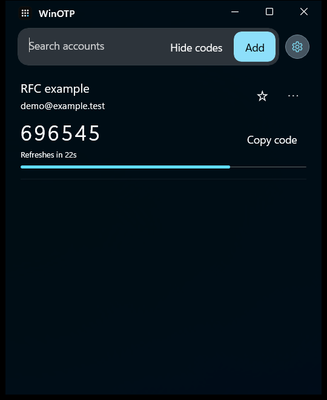

[English](README.md) · [العربية](README.ar.md) · [简体中文](README.zh-CN.md) · [繁體中文](README.zh-TW.md) · [Čeština](README.cs.md) · [Français](README.fr.md) · [Deutsch](README.de.md) · [Ελληνικά](README.el.md) · [Bahasa Indonesia](README.id.md) · [Gaeilge](README.ga.md) · [Italiano](README.it.md) · [日本語](README.ja.md) · [한국어](README.ko.md) · [Polski](README.pl.md) · [Română](README.ro.md) · [Русский](README.ru.md) · [Español](README.es.md) · [Українська](README.uk.md) · [اردو](README.ur.md) · [ئۇيغۇرچە](README.ug.md) · **Tiếng Việt**

<div align="center">


# WinOTP

**Mã của bạn. Thiết bị của bạn. Trình xác thực của bạn cho Windows 11.**

TOTP và HOTP trong một cửa sổ tối nhỏ gọn với màu sắc bắt nguồn từ giấy dán tường. Tìm kiếm, nhập và sao lưu được mã hóa mà không cần đăng ký hoặc đồng bộ hóa trên đám mây.

Được xây dựng bởi Vlad · [sailxx](https://github.com/sailxx).


[](LICENSE)

<br>


<a href="https://github.com/sailxx/WinOTP/releases"></a>&nbsp; &nbsp;<a href="https://github.com/sailxx/WinOTP/releases"></a>

Windows 11 · x64 · Giao diện tiếng Anh

</div>

<br>


<details>
<summary><b>Tìm hiểu thêm về các tính năng</b></summary>

### Mã dùng một lần

RFC 6238 TOTP và RFC 4226 HOTP ; SHA -1/256/512; 6 hoặc 8 chữ số. Thêm, chỉnh sửa, xóa và sao chép tài khoản và mã. Tìm kiếm và yêu thích giữ mục nhập phù hợp trong tầm tay.

### Mang theo tài khoản của bạn

Nhập URI otpauth, URI di chuyển Google Authenticator, hình ảnh QR và Aegis JSON . Xem trước các mục trước khi lưu và bỏ qua các tài khoản hiện có.

### Bản sao lưu được mã hóa

Cầm tay `.winotp` các tập tin sử dụng một mật khẩu riêng. Giữ riêng mật khẩu đó và xác minh việc khôi phục trước khi xóa dữ liệu nguồn.

</details>

<br>


<details>
<summary><b>Điều khiển và ảnh chụp màn hình ứng dụng</b></summary>

| Điều khiển | Hoạt động |
| --- | --- |
| **Thêm vào** | Tạo một tài khoản |
| **Ẩn mã / Hiển thị mã** | Che giấu hoặc tiết lộ mã |
| **Tìm kiếm tài khoản** | Tìm một dịch vụ hoặc tài khoản |
| **Thiết bị → Nhập khẩu** | Nhập tài khoản có bản xem trước |
| **Thiết bị → Sao lưu** | Tạo bản sao lưu được mã hóa |
| **Bánh răng → Cài đặt** | Định cấu hình khóa giao diện và thời gian chờ của clipboard; phiên bản ở dưới cùng |

Cuộn danh sách tài khoản bằng con lăn chuột hoặc cử chỉ; thanh cuộn bị ẩn. Giao diện tối vĩnh viễn sử dụng Mica Alt gốc với màu bắt nguồn từ hình nền khi được cài đặt Windows cho phép.

Ảnh chụp màn hình của một kho thử nghiệm riêng biệt với dữ liệu mẫu công khai:



</details>

<br>


<details>
<summary><b>Bảo vệ dữ liệu và các giới hạn của nó</b></summary>

Windows DPAPI bảo vệ vault cho người dùng Windows hiện tại. Bản sao lưu di động sử dụng AES -256- GCM và PBKDF2 - SHA256 với 600.000 lần lặp. Mật khẩu chính khóa **giao diện**, không bị phần mềm độc hại chạy với tư cách là người dùng Windows của bạn truy cập. Xóa bảng nhớ tạm không thể xóa lịch sử bảng nhớ tạm hoặc các bản sao do ứng dụng khác chụp.

Dữ liệu tồn tại trong `%LOCALAPPDATA%\WinOTP`. Quá trình di chuyển sao chép các tệp cũ từ `%LOCALAPPDATA%\NoirAuth` mà không loại bỏ bản gốc. Giữ chúng cho đến khi bạn xác minh được vault đã di chuyển và bản sao lưu có thể khôi phục. Nhìn thấy [SECURITY.md](SECURITY.md).

</details>

<br>


<details>
<summary><b>Cài đặt và cập nhật</b></summary>

1. Mở [phát hành](https://github.com/sailxx/WinOTP/releases) và đọc ghi chú của phiên bản đã chọn.
2. Đối với các bản phát hành mang tên mới, hãy tải xuống `WinOTP-Setup.exe`.
3. Chạy Setup và chọn một thư mục. Không có quyền quản trị viên được yêu cầu.

Dữ liệu được lưu trữ riêng biệt và được giữ lại khi gỡ cài đặt. Tạo bản sao lưu trước khi cập nhật. Giao diện ứng dụng và trình cài đặt sử dụng tiếng Anh.

Trình cài đặt không được ký mã Windows; SmartScreen có thể cảnh báo. Kiểm tra nguồn và tổng kiểm tra trước khi quyết định có chạy nó hay không.

</details>

<details>
<summary><b>Xác minh tải xuống của bạn</b></summary>

Tải xuống trình cài đặt và chạy:

```powershell
cd $HOME\Downloads
gh attestation verify WinOTP-Setup.exe --repo sailxx/WinOTP
Get-FileHash .\WinOTP-Setup.exe -Algorithm SHA256
```

So sánh hàm băm với giá trị SHA -256 bên cạnh trình cài đặt trong danh sách tài sản phát hành GitHub. Chứng minh không phải là ký mã Windows hoặc đảm bảo mã không có lỗ hổng bảo mật. Các bản phát hành cũ hơn có thể không bao gồm chứng thực.

</details>

<details>
<summary><b>Xây dựng từ nguồn</b></summary>

Yêu cầu Windows, . Công cụ xây dựng NET SDK 10 và WinUI. Thay thế đường dẫn trong lệnh đầu tiên bằng thư mục dự án của bạn.

```cmd
cd /d C:\path\to\WinOTP
dotnet run --project tests/OtpVectors/OtpVectors.csproj -c Release
dotnet build src/WinOTP/WinOTP.csproj -c Release -p:Platform=x64 -warnaserror
```

Cổng phát hành và hướng dẫn: [RELEASE.md](RELEASE.md). Thay đổi: [CHANGELOG.md](CHANGELOG.md). Tạo các bảng đồ họa với `python tools/generate_readme.py` từ gốc dự án.

</details>

<details>
<summary><b>Những hạn chế đã biết</b></summary>

- Giao diện người dùng Avalonia Linux và các công thức deb, vòng/phút và AppImage đã được chuẩn bị, đang chờ Linux chấp nhận và phê duyệt. [Cấu trúc và hạn chế](packaging/linux/README.md). Không có macOS hoặc đồng bộ hóa đám mây.
- Linux giữ bố cục và màu sắc nhỏ gọn với phông nền tối mờ đục và đi kèm Inter; Windows Mica Alt không có sẵn. Mật khẩu Linux mã hóa vault. Chuyển tài khoản Windows thông qua mã hóa mật khẩu `.winotp` hỗ trợ.
- Mica phụ thuộc vào phiên bản Windows và chính sách minh bạch. Việc thay đổi hình nền hoàn toàn và thử nghiệm chấp nhận trên nhiều quy mô vẫn cần thiết.
- Tệp kê khai MSIX là đầu vào đóng gói, không phải là gói đã được kiểm tra cài đặt và đã ký. Inno Setup là định dạng phân phối.
- Ghi chú của mỗi bản phát hành mô tả trạng thái xuất bản và xác minh của nó. Phiên bản địa phương được chuẩn bị sẵn không phải là bản phát hành đã xuất bản.

</details>

<details>
<summary><b>Giới thiệu và giấy phép</b></summary>

WinOTP được phát triển bởi Vlad ([sailxx](https://github.com/sailxx)). Nguồn có sẵn theo [Giấy phép MIT](LICENSE). Lỗi và đề xuất: [Vấn đề](https://github.com/sailxx/WinOTP/issues).

</details>
